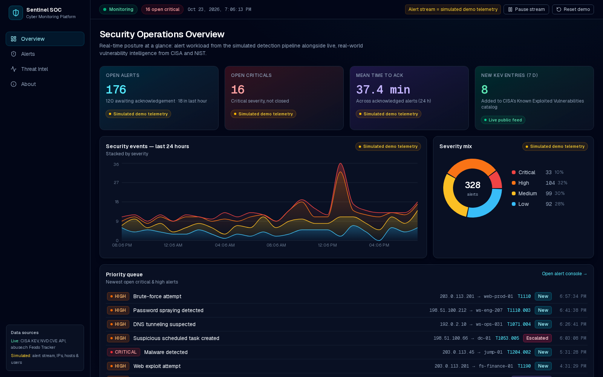
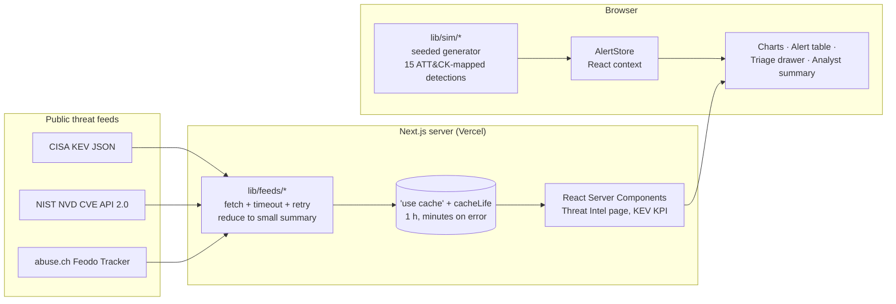

# Sentinel SOC — Cybersecurity Monitoring Platform

A SOC-style security dashboard that pairs **live, real-world threat intelligence** (CISA KEV, NIST NVD, abuse.ch) with a **simulated alert stream** for triaging security events, with every detection mapped to MITRE ATT&CK.

Built by **Stephanie Jones**, a U.S. military veteran and participant in Google's Launchpad for Veterans (Generative AI Leader) program, as a portfolio project for SOC and security analyst roles.

**Live demo:** https://cyber-monitor-gamma.vercel.app



> **Real data vs. simulated data**
> - **Real:** everything on the *Threat Intel* page and the *New KEV entries* KPI comes from public feeds, fetched server-side and cached.
> - **Simulated:** all alerts, source IPs, countries, hostnames, usernames, raw log lines and triage history are synthetic demo telemetry, and the UI labels them that way. Simulated attacker IPs come only from RFC 5737 documentation ranges (`192.0.2.0/24`, `198.51.100.0/24`, `203.0.113.0/24`), so no real host is accused. MITRE ATT&CK technique IDs are real.

---

## Features

### 1. Live threat intelligence (real data)
- **CISA Known Exploited Vulnerabilities (KEV):** catalog size, additions in the last 7 and 30 days, ransomware-linked count, a weekly additions chart, the most-listed vendors (all time and last 90 days), and the newest entries with federal remediation due dates.
- **NIST NVD CVE API 2.0:** critical and high (CVSS v3) CVEs published in the last 7 days, with score, CWE, description, severity filter and keyword search. No API key is used. Requests run one after another and the results are cached, which keeps the app well under the public limit of 5 requests per 30 seconds.
- **abuse.ch Feodo Tracker:** botnet command-and-control (C2) IP blocklist grouped by malware family and hosting country, plus the most recent entries.

### 2. Alert monitoring console (simulated telemetry)
- About 24 hours of generated history, then new events every 5 seconds. You can pause, resume or reset the stream.
- 15 detection types, each with a severity, source IP, target host/port, user, sensor, a realistic raw log line and a MITRE ATT&CK technique: failed logins (Win 4625), brute force (T1110), password spraying (T1110.003), port scans (T1046), malware (T1204.002), phishing (T1566.001), encoded PowerShell (T1059.001), C2 beaconing (T1071.001), DNS tunneling (T1071.004), web exploits (T1190), impossible travel (T1078), LSASS access (T1003.001), RDP lateral movement (T1021.001), exfiltration (T1048) and scheduled tasks (T1053.005).
- **Charts:** events over time stacked by severity, a severity donut, top attacking IPs, top source countries and alerts by ATT&CK tactic.
- **Alert table:** search by IP, host, user or ATT&CK ID, filter by severity and status, sort by column, and page through results.
- **Triage drawer:** acknowledge, escalate, close or re-open an alert, add case notes, see related activity from the same source IP, and follow a link to the ATT&CK technique page. Triage state lives only in browser memory.

### 3. Overview
- KPI cards: open alerts, open criticals, mean time to acknowledge (MTTA), and **new KEV entries this week (live)**.
- A 24-hour event timeline, the severity mix, a priority queue of open critical and high alerts, and the latest actively exploited vulnerabilities.

### 4. Analyst summary (rule-based, no paid API)
A **Generate summary** button writes a plain-English shift hand-off from the current queue: a risk level, key findings (volume, repeat sources, dominant techniques, later-stage tactics, MTTA) and recommended next steps. It is a transparent rule-based generator that runs in the browser and needs no LLM or API key.

### 5. About page
Explains the architecture, the data sources and the skills the project shows.

---

## Tech stack

| Layer | Choice |
|---|---|
| Framework | Next.js 16 (App Router, React Server Components, Cache Components) |
| Language | TypeScript (strict) |
| Styling | Tailwind CSS v4, custom dark SOC theme |
| Charts | Recharts |
| Icons | lucide-react |
| Hosting | Vercel |

## Architecture



**Key design decisions**
- **Server-side fetching and caching.** Feeds are fetched only on the server, inside `"use cache"` functions. The roughly 2 MB KEV JSON is reduced to a few KB before it is cached, so pages are prerendered and revalidated hourly. If a feed fails, the result is cached for only a few minutes, and the UI shows a friendly error instead of crashing.
- **Respecting upstream limits.** NVD is called without a key, with two sequential requests (critical, then high) and a pause between them, at most once an hour. Every request sends a descriptive User-Agent, has a timeout and retries with backoff.
- **No hydration mismatches.** The simulated history depends on the current time, so it is generated in the browser after mount. The prerendered HTML holds only the layout and the live data.
- **Typed, small modules.** `lib/feeds` (one file per source), `lib/sim` (types, detection catalog, generator, metrics, summary) and `components` (presentational and stateful pieces).

```
src/
├─ app/                  # routes: / (overview), /alerts, /threat-intel, /about
├─ components/           # UI: shell, charts, alert table/drawer, intel sections, store
└─ lib/
   ├─ feeds/             # kev.ts, nvd.ts, feodo.ts, http.ts (fetch helper)
   └─ sim/               # types, catalog (detections), generator, metrics, summary
```

## Data sources

| Source | Type | Used for |
|---|---|---|
| [CISA KEV catalog](https://www.cisa.gov/known-exploited-vulnerabilities-catalog) ([JSON](https://www.cisa.gov/sites/default/files/feeds/known_exploited_vulnerabilities.json)) | **Real**, public | KEV stats, vendors, recent additions, KPI |
| [NIST NVD CVE API 2.0](https://nvd.nist.gov/developers/vulnerabilities) | **Real**, public, no key | Recent critical and high CVEs |
| [abuse.ch Feodo Tracker](https://feodotracker.abuse.ch/) | **Real**, public | Botnet C2 blocklist |
| [MITRE ATT&CK](https://attack.mitre.org/) | Reference | Technique IDs, names and tactics |
| Built-in simulator (`src/lib/sim`) | **Simulated** | Alerts, IPs, geo, hosts, users, logs, triage history |

_This product uses data from the NVD API but is not endorsed or certified by the NVD._

## Run it locally

Requires Node.js 20 or later.

```bash
git clone <this-repo-url> cyber-monitor
cd cyber-monitor
npm install
npm run dev          # http://localhost:3000
# or a production build:
npm run build && npm start
```

No environment variables or API keys are required.

## What this demonstrates for SOC and security analyst roles

- **Alert triage and incident workflow:** prioritizing by severity, the acknowledge → escalate → close lifecycle, case notes, pivoting on an indicator (source IP) to related activity, and measuring MTTA.
- **MITRE ATT&CK fluency:** mapping detections to techniques and tactics, and recognizing later-stage activity (credential access, lateral movement, C2, exfiltration).
- **Log literacy:** event formats modeled on Windows Security (4624, 4625, 4698), Sysmon (1, 10), Suricata, Zeek, WAF, firewall and IdP logs.
- **Vulnerability management:** using CISA KEV to prioritize patching (actively exploited, federal due dates, ransomware use) and watching newly published critical and high CVEs.
- **Threat intelligence consumption:** turning public feeds into actionable views (C2 infrastructure, vendor exposure).
- **Clear communication:** the analyst summary turns a noisy queue into a concise hand-off with recommended actions.
- **Engineering practices:** TypeScript, server-side data handling, caching and rate-limit awareness, graceful failure handling, responsible use of data (no fabricated real-world data; simulated IPs use documentation ranges) and a production deployment.

## Limitations

- The alert stream is simulated and triage state resets on page reload. A real deployment would ingest from a SIEM (for example Splunk, Elastic or Microsoft Sentinel) and keep cases in a database.
- Threat feeds refresh at most hourly, because of caching.
- The analyst summary is rule-based by design. An LLM could be added behind a server route if an API key were available.

---

© Stephanie Jones. MITRE ATT&CK® is a registered trademark of The MITRE Corporation.
